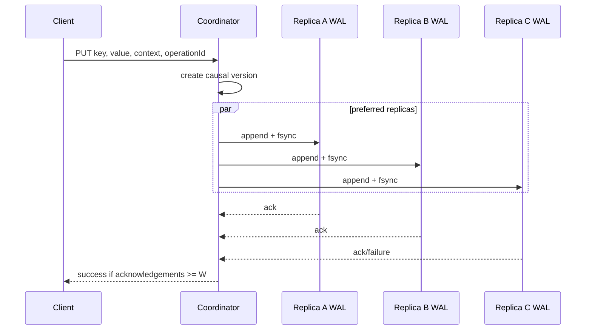

# Quorum KV: durability and conflict evidence

A dependency-free Node.js protocol lab for a replicated single-key store. It combines strict replica placement, configurable read/write quorums, causal versions, conflict-preserving reads, synchronous read repair, checksummed append-only WALs, and an HTTP vertical slice.

The repository is built around one correction: `R + W > N` is an overlap condition, not a standalone proof of linearizability. It only helps under the same replica set and placement version, and it still needs a version protocol, failure semantics, and a definition of what a read returns.

## Quick start

Requires Node.js 22 or newer.

```sh
npm ci --ignore-scripts
npm run check

LOG_HMAC_SECRET='replace-with-at-least-32-random-bytes' \
DATA_DIRECTORY='.data' \
npm start
```

In another shell:

```sh
curl -i -X PUT http://127.0.0.1:3000/v1/kv/cart-42 \
  -H 'content-type: application/json' \
  -H 'idempotency-key: create-cart-42' \
  --data '{"value":{"items":["book"]}}'

curl -i http://127.0.0.1:3000/v1/kv/cart-42
```

The default process opens three local replica WALs with `N=3, W=2, R=2`. The replicas share one process, so the executable proves protocol and process-crash behavior—not multi-host failure independence.

## Problem contract

### User and scenario

The user is an application that stores JSON values by exact key and can reconcile concurrent versions. It prefers preserving acknowledged updates over silently choosing a wall-clock winner.

### Functional requirements

- `PUT`, `GET`, and causal `DELETE` for one key at a time.
- Three deterministic preferred replicas by default, with strict membership and configurable `N/R/W`.
- Return an acknowledged write only after enough replica WAL appends have been synced.
- Preserve incomparable causal versions as siblings; return their merged context for an application resolution write.
- Make a byte-identical retry with the same operation ID idempotent; reject detectable ID reuse with different content.
- Repair reachable stale replicas during reads.
- Refuse startup on truncated or checksum-corrupt WAL data.
- Expose health, aggregate metrics, bounded HTTP input, structured logs, and graceful shutdown.

### Non-goals

- Linearizable reads/writes, compare-and-set, multi-key transactions, range scans, secondary indexes, or a query language.
- Gossip membership, health detection, automatic reconfiguration, sloppy quorum, hinted handoff, Merkle anti-entropy, cross-region placement, or consensus.
- SSTables, compaction, Bloom filters, snapshots, backup, encryption, or a production storage engine.

The excluded features are not forgotten components. Adding them before the current consistency and durability claims are executable would hide the important failure windows under more machinery.

## Read and write behavior



A failed write can still be present on one replica. The error therefore includes `partial: true`; a retry must reuse the same operation ID, value, and context. A later quorum read merges non-dominated versions and repairs reachable stale replicas. Concurrent siblings return HTTP `409` with a merged context rather than losing one branch.

[Architecture](docs/architecture.md) specifies the invariants and failure windows. [API](docs/api.md) defines the HTTP contract.

## Back-of-the-envelope estimate

Assume one million live keys, a 1 KiB average encoded value, and replication factor 3:

- logical values: about 1 GiB before key, version, object, index, and filesystem overhead;
- replicated value bytes: about 3 GiB before WAL history and repair traffic;
- at 1,000 writes/s, a 1 KiB value replicated three ways is roughly 3 MiB/s of value payload before protocol and filesystem overhead;
- every acknowledged mutation remains in the append-only WAL because v0.1 has no snapshot or compaction.

That last item is the decisive stop line: this build is intentionally unsuitable for an unbounded dataset. `npm run benchmark` emits environment-bound fsync and in-memory-read receipts, not a capacity promise.

## What the implementation proves

- A write acknowledged by `W` strict preferred replicas can be recovered from the replica WALs after a process `SIGKILL` in the tested filesystem environment.
- A failed write reports partial durability instead of pretending no side effect occurred.
- Equal retries do not add WAL records; conflicting operation-ID reuse fails closed once observed.
- Causal descendants replace ancestors, incomparable versions survive, tombstones remain causal state, and a client merge dominates all returned siblings.
- Read repair converges a reachable replica that missed an acknowledged write.
- A test with two placement fingerprints shows why numeric `R + W > N` alone can still return stale or missing data.

It does not prove power-loss durability, directory-entry persistence, multi-host availability, linearizability, production security, deployment, SLA, or external acceptance. Full receipts are in [Verification](docs/verification.md).

## Repository map

- `src/version.js`: vector-clock context, immutable versions, sibling reduction, and operation identity.
- `src/placement.js`: deterministic rendezvous preference lists and configuration fingerprint.
- `src/replica-store.js`: checksummed append-only WAL, fsync-before-ack, replay, and fail-closed corruption detection.
- `src/cluster.js`: strict `N/R/W` coordinator, partial-write receipts, reads, and repair.
- `src/http-server.js`: bounded JSON API, HMAC key tags, health, metrics, and error mapping.
- `test/`: causal, durable, quorum, membership-drift, HTTP, and boundary evidence.
- `scripts/`: static audit, process-crash recovery smoke, and local benchmark.
- `docs/operations.md`: run, alert, recovery, and compaction stop lines.

## Source and clean-room note

The problem was prompted by the `Key-Value Store` chapter in [`liquidslr/system-design-notes`](https://github.com/liquidslr/system-design-notes/tree/9d8388721e7231442763ad37398b8d82224aa68f). That source tree did not declare a license at the reviewed commit, so no prose, figures, or code were copied.

The design was calibrated against [Amazon's Dynamo paper and author page](https://www.allthingsdistributed.com/2007/10/amazons_dynamo.html), [Attiya–Bar-Noy–Dolev atomic-register research](https://research.ibm.com/publications/sharing-memory-robustly-in-message-passing-systems), the [Gilbert–Lynch CAP result](https://sites.cs.ucsb.edu/~rich/class/cs293b-cloud/papers/cap-proof.pdf), and [Apache Cassandra's documented guarantees](https://cassandra.apache.org/doc/latest/cassandra/architecture/guarantees.html). These systems and papers have different contracts; they are evidence for distinctions, not a claim that this lab implements them.

## License

[MIT](LICENSE)
