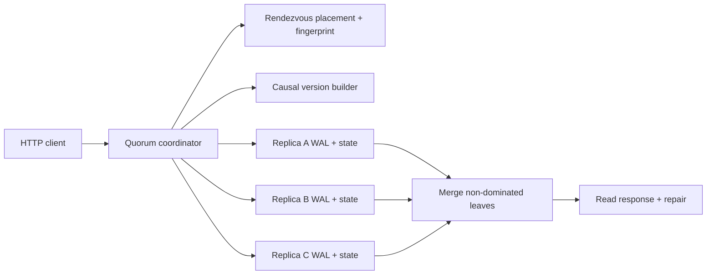

# Architecture

## Boundary

This build is a single-process executable model of a distributed single-key protocol. Each logical replica has an independent WAL directory, but all replicas share a process, event loop, host filesystem, and failure domain. The injected network can block coordinator-to-replica edges in library tests; it is not a socket transport.

## Placement

Rendezvous hashing ranks every physical node for a key using a domain-separated SHA-256 score. The first `N` nodes form the strict preference list. Membership order does not affect the result, and all node IDs plus the placement algorithm version form a fingerprint.

The prior system-design case implemented a virtual-node ring. This case chooses rendezvous placement to keep the storage protocol independent and expose that consistent placement has multiple valid implementations. Scoring every physical node costs `O(P)` per key; this is acceptable for the small lab and not presented as a large-cluster optimization.

## Version model

Every mutation contains:

- application value or tombstone;
- client-supplied causal context;
- coordinator writer ID;
- operation ID;
- vector clock created by incrementing the coordinator entry;
- content-derived SHA-256 version ID.

Clock comparison is a partial order. A strict descendant removes its ancestors. Incomparable clocks remain siblings. Equal clocks with different event identities also remain siblings as a conservative response to coordinator restart or concurrent requests from the same stale context. No physical timestamp chooses a winner.

## Durable replica

Before acknowledging a new version, a replica:

1. validates key, operation identity, version ID, clock, and value bounds;
2. builds a canonical payload and SHA-256 checksum;
3. appends one newline-framed JSON record;
4. calls file `sync`;
5. closes the descriptor;
6. only then mutates the in-memory materialized state.

Startup replays all complete frames, verifies checksums and version identities, and refuses truncated or conflicting history. This ordering proves process-crash recovery in the smoke test. It does not prove sudden-power-loss or storage-device durability because the parent directory is not separately synced and the test uses one host filesystem.

## Quorum protocol

For one placement fingerprint and strict preferred set:

- write sends to all `N` preferred replicas and succeeds when at least `W` durable acknowledgements exist;
- read queries all reachable preferred replicas and succeeds when at least `R` respond;
- read merges causal leaves from responses and synchronously attempts repair of missing leaves on those responding replicas;
- `R + W > N` is reported as an overlap property.

This is not linearizable. There is no leader, total order, compare-and-set, read write-back phase for an atomic-register algorithm, or consensus-backed reconfiguration. Blind or concurrent updates may return siblings. A failed write may be partially durable.

## Invariants

1. A replica acknowledgement follows a synced complete WAL frame.
2. Replaying a valid WAL reconstructs the same non-dominated version set.
3. The same operation ID and content is idempotent at every replica; conflicting reuse never silently overwrites once observed.
4. No causal ancestor or concurrent sibling is discarded by wall-clock order.
5. A successful write has at least `W` acknowledgements from the exact preference list in its receipt.
6. A successful read has at least `R` responses from its exact preference list and never fabricates unavailable state.
7. Read repair is counted as attempted, applied, or failed; a read result does not claim unreachable replicas converged.
8. Tombstones remain versions until an external retention and repair proof allows reclamation.

## Failure windows

| Window | Result | Safe caller response |
|---|---|---|
| Fewer than `W` acknowledgements | Write returns `503`, but `partial` may be true | Retry identical mutation; do not assume rollback |
| Fewer than `R` read responses | Read returns `503` | Do not substitute cached absence as truth |
| Concurrent contexts | Multiple siblings | Apply domain merge and write with merged context |
| Operation ID reused differently | Local or convergence conflict | Stop retry; investigate caller identity bug |
| Fingerprints disagree | Numeric quorum sets may not intersect | Block activation/migration until configuration converges |
| WAL tail/checksum invalid | Replica refuses startup | Restore/repair from verified replicas; never discard silently |
| Delete before all branches observed | Value/tombstone conflict | Reconcile with causal context; do not physically purge |
| Process dies after client response | WAL replay restores acknowledged versions in tested environment | Restart and verify receipt; power loss remains separate |

## Complexity

With `P` physical nodes, `N` replicas, `S` stored siblings, and `L` WAL records:

- placement: `O(P log P)` in this simple full ranking;
- write: `N` appends and syncs, executed concurrently;
- read: `O(N * S²)` for the intentionally small sibling merge plus repair writes;
- startup: `O(L)` replay;
- storage: `O(L)` because v0.1 has no compaction.

Sibling, clock, value, request, and node counts are bounded to keep adversarial growth visible. WAL growth remains the explicit operational stop line.
